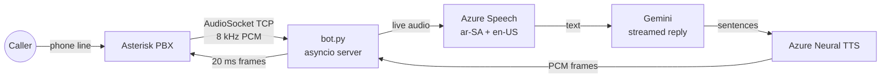

# Dermeen: Arabic AI Voice Agent for Phone Calls

A real-time AI agent that answers real customer phone calls in **Saudi Arabic and English**. It runs in production on a company's Asterisk phone system: it greets the caller, answers questions from a knowledge base, takes maintenance bookings and hangs up when the conversation is done.

## How it works



1. Asterisk opens one TCP connection per call using the **AudioSocket** protocol, a simple binary format of kind, length and payload.
2. Caller audio is pushed into **Azure Speech** continuous recognition, which detects Saudi Arabic or English automatically.
3. Each finished utterance goes to **Gemini** together with the conversation history. The reply is **streamed** and cut into sentences, so the agent starts speaking before the full answer is generated.
4. Each sentence is turned into 8 kHz speech by **Azure Neural TTS**. An Arabic or English voice is picked automatically.
5. Audio is sent back in real-time 20 ms frames.

## Engineering details

- **Barge-in:** when the caller starts talking, partial recognition results cancel the current reply and clear the audio queue immediately.
- **Low latency:** LLM streaming plus sentence chunking (`take_sentences`) means the caller hears the first sentence while the rest is still being generated. Model "thinking" is turned off for speed.
- **Natural speech:** the system prompt makes the model write in speakable Arabic: numbers as words, phone numbers digit by digit, and no lists or symbols.
- **Clean hang-up:** the model adds an `[END]` tag after saying goodbye. The agent finishes speaking, then sends an AudioSocket hangup frame.
- **Resilience:** a failed LLM reply does not drop the call. The agent asks the caller to repeat.
- **Full transcript** of every call is logged as JSON for review.

## Run it

```bash
cp .env.example .env   # add your Azure Speech and Gemini keys
docker build -t voice-agent .
docker run --env-file .env -p 9092:9092 voice-agent
```

Asterisk dialplan example:

```
exten => 100,1,Answer()
 same => n,AudioSocket(${UUID()},voice-agent-host:9092)
 same => n,Hangup()
```

Edit `prompt.md` (personality and rules) and `knowledge.md` (products, prices, hours) to use it for another business. The files here contain sample data.

## Stack

Python 3.11 (asyncio) · Asterisk AudioSocket · Azure Cognitive Services Speech · Google Gemini API (`google-genai`) · Docker
